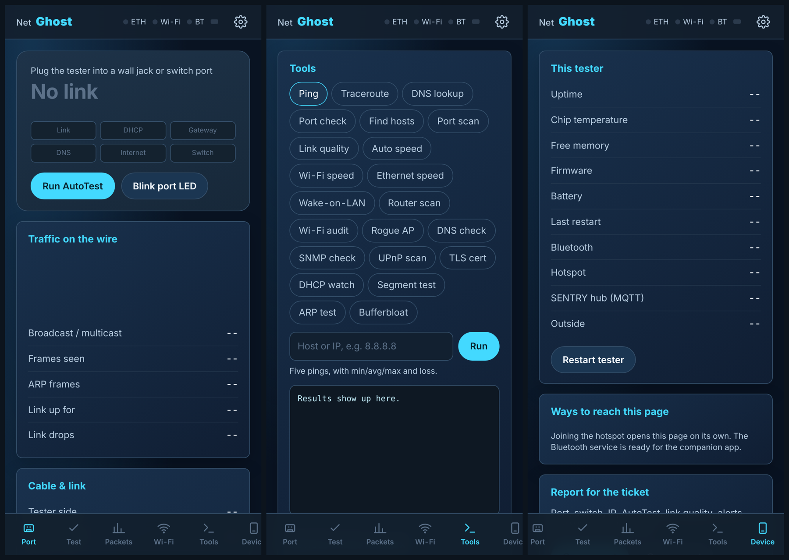
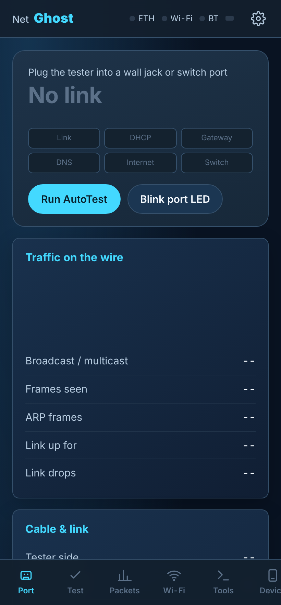
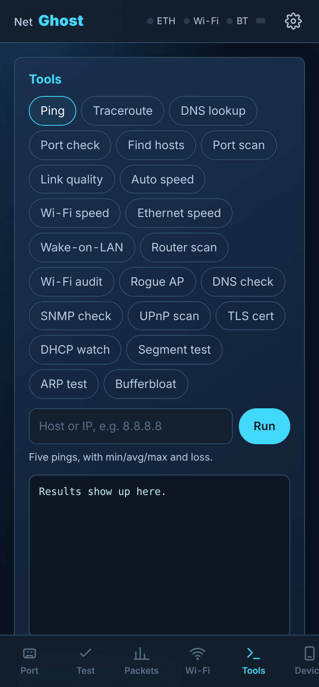
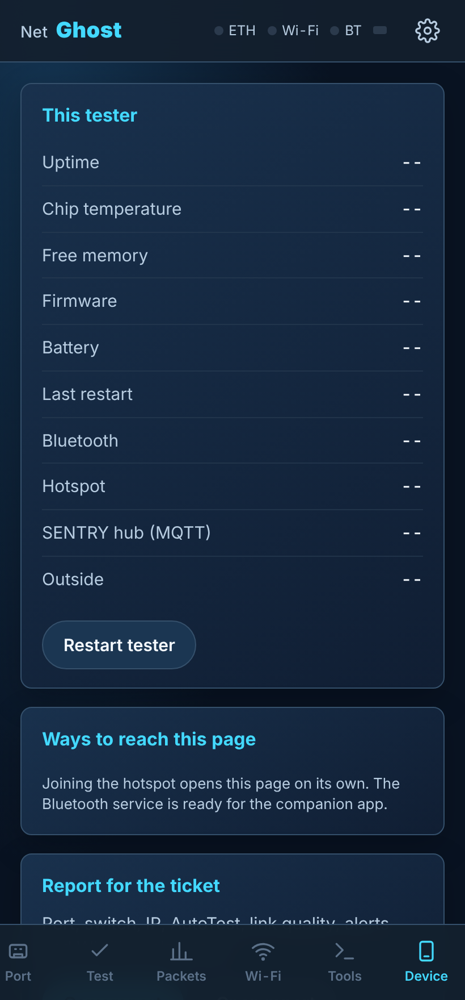

# Net Ghost

A handheld network diagnostics and security tester built on an ESP32-S3. It plugs into a wall jack or switch port, runs a full set of wired and Wi-Fi checks, and shows the results three ways: on its own round touchscreen, on a phone or laptop through a web interface the device serves itself, and over Bluetooth LE. Written in C on ESP-IDF, with an LVGL touch UI.

It started as an environmental monitor for network closets ([sentry-prototype](https://github.com/youssefamarir/sentry-prototype)) and grew into a tester for IT technicians.



## What it does

**Wired diagnostics**
- AutoTest on plug-in: link, DHCP, gateway, DNS, internet (HTTPS), and switch, each pass/warn/fail with timing
- Switch and port discovery over LLDP, LLDP-MED, CDP and FDP: switch name, port, data and voice VLAN, mode, management IP, model, PoE advertisements
- Live port statistics: negotiated speed/duplex, frames/s, broadcast/multicast share, link uptime and drops, and a "blink port" that flashes the switch port LED to find it
- Packet analyzer with protocol breakdown, top talkers, and `.pcap` export for Wireshark
- IP configuration, DHCP renew, static addressing

**Wi-Fi**
- Signal, SSID, channel, PHY mode, security, BSSID
- Scan: strongest networks, open networks flagged, channel load, quietest of 1/6/11

**Network tools** (on the screen and in the GUI)
- Ping, traceroute, DNS lookup, TCP port check, 21-port common scan, subnet host inventory (IP, MAC, vendor, name), link quality (100-ping loss/latency/jitter), Wake-on-LAN, bufferbloat grade

**Security audit — read-only**

These look for weak settings on your own network. They do not attack, spoof, deauthenticate, or capture anyone else's traffic.
- Router scan (risky open admin services on the gateway), Wi-Fi audit (open/WEP/old-WPA, WPA3 adoption), rogue-AP / evil-twin detection, DNS hijack check, SNMP default-community check, UPnP exposure scan, TLS certificate/version/expiry check, rogue-DHCP watch, segment/VLAN isolation test, and an ARP-inspection self-test that proves whether the LAN lacks Dynamic ARP Inspection by announcing only the device's own address.

**Interfaces**
- On-device LVGL UI with a 2-D column layout (Device / Switch / Wi-Fi / Tools / Security / Settings / Connect)
- Web GUI served from the board's own Wi-Fi hotspot, with captive portal and a QR code to join
- Bluetooth LE service and a web-Bluetooth GUI with PIN pairing, for a companion app

### Not built, by design

Keyloggers, BadUSB/HID injection, gateway ARP-spoofing, Wi-Fi deauth, or anything that captures or redirects someone else's data. Those are attacks, not susceptibility checks. The security tools here are read-only audits of a network you own.

## Hardware

Waveshare ESP32-S3-ETH (W5500 Ethernet + PoE module) with a 1.28" GC9A01 round touchscreen and CST816S touch.

| Signal | GPIO |
|---|---:|
| LCD SCLK / MOSI / MISO | 38 / 40 / 39 |
| LCD CS / DC / RST / BL | 42 / 41 / 18 / 15 |
| Touch SDA / SCL / INT / RST | 17 / 16 / 43 / 44 (I2C addr 0x15) |
| W5500 SCLK / MISO / MOSI / CS | 13 / 12 / 11 / 14 |
| W5500 INT / RST | 10 / 9 |

GPIO numbers, not header positions. Keep your known-working VCC/GND wiring.

## Build and flash

Firmware is C on ESP-IDF 5.5 with LVGL 8.4, built through PlatformIO.

1. Copy `src/secrets.example.h` to `src/secrets.h`. Every value is optional and can also be set later from the GUI, so the defaults are fine to start.
2. Build and flash from PlatformIO:
   ```
   pio run -t upload
   ```
3. Prebuilt binaries are in `firmware/` if you'd rather flash without building. Ubuntu flashing steps are in [FLASH_UBUNTU.md](FLASH_UBUNTU.md).

The on-device web GUI is generated from `web/index.html` into `src/web_page.h` at build time by `tools/make_web.py` — edit the HTML, not the generated header.

## What it measures, and what it can't

The board is honest about its hardware limits rather than printing invented numbers:
- **Cable length and four-pair wiremap:** not available — the W5500 has no TDR or pair-testing hardware.
- **PoE voltage/current/watts:** not measured — the PoE module is a power supply, not a meter. PoE values come only from switch LLDP/CDP advertisements.
- **Speed test:** a bounded single-connection HTTPS throughput sample on the tester (via Cloudflare), not an ISP-plan measurement. The ESP32-S3 is a 2.4 GHz single-antenna radio doing HTTPS on its own CPU, so expect ~15–30 Mbps on Wi-Fi and ~5–10 Mbps on Ethernet (W5500 over SPI). The board is the bottleneck, not the link.

Full details are in [CHANGELOG.md](CHANGELOG.md), and the exact tests run against each build are in [VALIDATION.md](VALIDATION.md).

## Repo layout

| Path | Contents |
|---|---|
| `src/` | Firmware (display, UI, Wi-Fi, Ethernet, web server, BLE, tools, packets, security, switch config) |
| `web/` | Web and Bluetooth GUI source (`index.html`, `ble.html`) |
| `components/libssh2/` | On-device SSH client for the switch VLAN configurator |
| `firmware/` | Prebuilt binaries and build log |
| `tests/` | PoE decoder and JSON fixture tests |
| `FLASH_UBUNTU.md` / `VALIDATION.md` / `CHANGELOG.md` | Flashing, validation status, version history |

## Screenshots

The web interface (served by the device):

| Port | Tools | Device |
|---|---|---|
|  |  |  |

*(The round on-device screen has its own UI; add photos of the hardware here.)*
